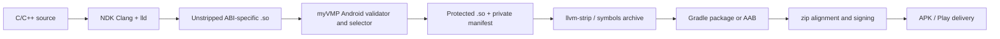

# Android Native Protection — Long-Term Research Plan

[中文](zh-CN/android-vision.md)

> Status: research only. This document does not describe a supported target and does not
> authorize implementation. “Android protection” here means selected functions in NDK
> shared libraries, not Java/Kotlin/Dex, resources, or an entire APK.

## Executive conclusion

An Android `arm64-v8a` proof of concept can reuse much of myVMP, but production Android
support is not a small file-format switch. Android native code is ELF, so the AArch64
decoder, IR, bytecode, dynamic profiles, multi-VM model and most runtime semantics are
valuable immediately. The difficult work is safe ET_DYN rewriting under Android linker
rules, build-pipeline placement, stripped-symbol selection, 4/16 KiB page compatibility,
APK/AAB packaging and signing, and validation across API levels and devices.

The recommended long-term objective is therefore an **Android NDK-library protection
pipeline**, beginning with `arm64-v8a`. It should transform unstripped `.so` outputs after
native linking and before stripping, packaging, alignment and signing. Direct mutation of
a signed APK is the wrong primary architecture.

Under the assumptions of one experienced binary-tooling engineer and a controlled sample
app, an arm64 proof of concept is likely several engineer-weeks. A production arm64-v8a
integration is more plausibly a multi-month effort once compatibility and release gates
are included. Broad ABI coverage is substantially larger: `armeabi-v7a` normally emits
Thumb-2, while x86/x86-64 require new backends. These are planning ranges, not schedules.

## What an Android app actually contains

Android apps commonly combine ART bytecode and native shared libraries. NDK libraries are
ELF files placed at `lib/<abi>/lib<name>.so` inside an APK; supported NDK ABIs currently
include `armeabi-v7a`, `arm64-v8a`, `x86`, and `x86_64`. Android is little-endian. A fat APK
may carry several ABI copies, while App Bundles let Google Play generate device-specific
APKs. [Android ABI documentation](https://developer.android.com/ndk/guides/abis)

The native library is loaded by `System.loadLibrary`, Bionic's dynamic linker and the
platform namespace policy. JNI methods may be found by exported names, but Android's
recommended model is `JNI_OnLoad` plus `RegisterNatives`, often with every other symbol
hidden by a version script. This makes a release `.so` a hostile input for name-based
function selection unless protection happens before strip or consumes a linker-produced
selection manifest. [JNI guidance](https://developer.android.com/ndk/guides/jni-tips),
[symbol visibility](https://developer.android.com/ndk/guides/symbol-visibility)

Native libraries may remain uncompressed and be loaded directly from the APK rather than
extracted. Current Android guidance also requires native dependencies and ELF load
segments to work with 16 KiB page-size devices; NDK r28 makes 16 KiB ELF alignment the
default. [Packaging behavior](https://developer.android.com/guide/topics/manifest/application-element),
[16 KiB page guidance](https://developer.android.com/guide/practices/page-sizes)

## Recommended pipeline

The transformer belongs before packaging and signing. `apksigner` explicitly warns that
changing an APK after signing invalidates its signature and that `zipalign` must precede
signing. A post-package fallback could unpack an unsigned APK, transform every selected
ABI library, rebuild, align and sign it, but it is more fragile and does not map cleanly
to Play-generated APKs from an AAB. [apksigner documentation](https://developer.android.com/tools/apksigner),
[app signing](https://developer.android.com/studio/publish/app-signing),
[bundle/command-line build](https://developer.android.com/build/building-cmdline)

The preferred integration points are:

1. a standalone command that accepts one unstripped NDK `.so`, ABI, symbol/range manifest,
   minimum SDK and output path;
2. a stable Gradle-facing wrapper that operates on native build artifacts without making
   the core library depend on Android Gradle Plugin internals;
3. optional CMake/ndk-build examples that run after link and before strip/package;
4. a packaging verifier, not an APK signer: signing keys must remain owned by the existing
   Android release system.

## Reuse of the current project

| Existing component | Reuse outlook | Android-specific work |
|---|---:|---|
| AArch64 decoder/lifter and scalar semantics | High | Expand NDK/Clang corpus and Android call/addressing forms |
| ARM32 A32 frontend | Limited | NDK emits Thumb-2 by default; forcing ARM mode is only a constrained fallback |
| RV64 frontend | Future only | Not a current public NDK app ABI; do not expose as Android support yet |
| Common IR, bytecode and operand codec | Very high | Add Android qualification, limits and manifest fields |
| Dynamic/sibling multi-VM | High | Validate JNI calls, exceptions, threads and realistic stack budgets |
| Native runtime assembly | High for arm64 | Android/Bionic ABI audit, BTI/PAC properties and unwinding policy |
| ELF parser and planner | Medium-high | Android relocations, notes, dynamic tags, RELR/packed forms and strict ET_DYN tests |
| ELF writer/detours | Medium | Preserve 4/16 KiB PT_LOAD alignment, GNU RELRO and loadability from APK |
| Sidecars and quality reports | High | Keep detailed manifests outside the shipped APK by default |
| QEMU Linux tests | Partial | Add emulator/device, `adb`, `logcat`, JNI and API-level matrices |

The current runtime executes native interpreter code from an executable ELF mapping and
keeps mutable bytecode/state in data/stack memory, so it does not inherently require a
JIT-style writable-and-executable mapping. That is a useful fit for Android W^X policy,
but it must be verified on real Android loaders rather than inferred from Linux QEMU.

## Required engineering work

### 1. Define the supported artifact and ABI contract

- Scope v1 to app-owned NDK `.so` files, initially `arm64-v8a` and selected scalar
  functions; explicitly exclude framework/system libraries, DEX and resources.
- Record `minSdk`, ABI, NDK/Clang/LLD/AGP versions, page-size mode and JNI registration
  strategy in a build manifest.
- Decide whether C++ exceptions/unwind tables, sanitizers, LTO and CFI are rejected first
  or supported with explicit metadata repair.

### 2. Make function selection survive release builds

- Protect before strip whenever possible.
- Support a source/link-time selection file containing stable symbol, section, address
  range and optional build ID, rather than depending only on `.symtab`.
- Preserve `JNI_OnLoad`, exported JNI entry points and every address referenced by
  `RegisterNatives`; verify that detours do not invalidate registration tables.
- Define behavior for identical code folding, LTO cloning, COMDAT and local/hidden symbols.

### 3. Harden ELF rewriting for Android ET_DYN

- Build a corpus from multiple NDK releases and API levels.
- Validate Android/AArch64 and ARM relocation families, GNU/Android RELR or packed
  relocation metadata, `.dynamic`, GNU hash, build ID, symbol versions and RELRO.
- Preserve `p_offset ≡ p_vaddr (mod p_align)` and both 4 KiB and 16 KiB PT_LOAD alignment.
- Test PIE load bias, ASLR, direct-from-APK loading, lazy/eager binding and linker
  namespaces. Android's Bionic notes document platform-specific linker evolution,
  including RELR compatibility. [Bionic linker changes](https://android.googlesource.com/platform/bionic/+/master/android-changes-for-ndk-developers.md)
- Decide how unwind metadata is handled. The safe first policy is to reject selected
  functions whose exception/unwind behavior cannot be preserved.

### 4. Qualify runtime and ABI behavior

- Test JNI ordinary, `@FastNative` and `@CriticalNative` entry ABIs separately; the latter
  changes the native signature and has API-level constraints.
- Verify thread-local `JNIEnv`, callbacks into ART, native helpers, signals, stack
  alignment, alternate thread stack sizes and recursion depth.
- Audit AArch64 GNU properties and modern control-flow features such as BTI/PAC when
  emitted by the toolchain; never remove a property merely to make a fixture load.
- Measure startup, JNI-call latency, memory, APK/AAB size and per-function overhead on
  physical devices, not only emulators.

### 5. Integrate packaging without owning secrets

- Produce transformed `.so` artifacts for Gradle to package through `jniLibs` or the
  external native build pipeline. Android supports both CMake/ndk-build integration and
  prebuilt libraries. [Gradle native build integration](https://developer.android.com/studio/projects/gradle-external-native-builds),
  [NDK CMake toolchain](https://developer.android.com/ndk/guides/cmake)
- Verify ABI directory placement, compression and ZIP/page alignment.
- Let Gradle, Play App Signing or the owner's existing release system sign outputs; myVMP
  must not accept or store production signing keys.
- Treat detailed protection manifests and seeds as private CI artifacts, not APK assets.

### 6. Add Android-specific release gates

- Minimal JNI app with deterministic native behavior for each supported ABI.
- Debug/release, stripped/unstripped, APK/AAB, extracted/direct-load and 4/16 KiB cases.
- Emulator matrix plus representative physical devices/API levels; compare JNI results,
  crashes, `logcat`, load time and memory.
- `readelf`/`llvm-readobj`, `zipalign -c`, `apksigner verify`, `bundletool` alignment checks
  and installation/upgrade tests.
- Negative fixtures for stripped selection, unsupported relocations, Thumb input,
  malformed packages, unwind/CFI conflicts and insufficient detour space.

## Difficulty by target

| Milestone | Relative difficulty | Reason |
|---|---:|---|
| Standalone arm64-v8a `.so` proof of concept | Medium | Core ISA and VM exist; Android ET_DYN and packaging validation do not |
| Production arm64-v8a Gradle pipeline | High | Toolchain/version matrix, symbols, 16 KiB, signing order and device qualification |
| Constrained armeabi-v7a built with `-marm` | Medium-high | Existing A32 can help, but compiler corpus and Android ABI still need qualification |
| Normal armeabi-v7a support | Very high | NDK defaults to Thumb-2 and permits Neon, neither covered by the A32 backend |
| x86/x86_64 Android support | Very high | Requires new ISA frontends, runtimes and detours |
| Java/Kotlin/Dex obfuscation | Separate project | Different formats, runtime and threat model; existing native VM is not a shortcut |
| Turnkey APK/AAB multi-ABI product | Very high/ongoing | Combines every backend with Gradle, Play delivery and long-lived compatibility testing |

## Recommended staged roadmap

1. **Feasibility corpus:** collect unstripped/stripped arm64-v8a libraries from supported
   NDK versions; report liftability and layout compatibility without writing files.
2. **Standalone arm64 `.so`:** protect one hidden scalar function selected before strip;
   load it in a minimal JNI app on emulator and a 16 KiB-capable device image.
3. **Android-safe writer:** pass relocation, RELRO, 4/16 KiB, direct-from-APK and malformed
   input gates; publish an Android-specific manifest schema.
4. **Build integration:** add a versioned standalone wrapper and sample Gradle/CMake hook,
   then verify APK and AAB workflows before signing.
5. **Production qualification:** NDK/AGP/API/device matrix, performance budgets, crash
   diagnostics, reproducibility and upgrade testing.
6. **ABI expansion:** choose Thumb-2 or x86-64 based on actual deployment demand; do not
   claim full Android coverage while only arm64-v8a is protected.

## Decision gates before implementation

Implementation should begin only after the project chooses a minimum Android API level,
supported NDK/AGP range, initial ABI, symbol-selection integration and policy for unwind,
LTO/CFI and 16 KiB devices. The first deliverable should be a compatibility/liftability
report, not an APK rewriting command.

