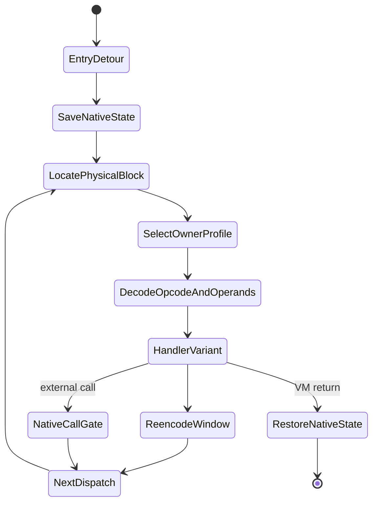

# Architecture and Protection Pipeline

[中文](zh-CN/architecture.md)

## Scope

myVMP is a host-side binary transformer. Its unit of protection is a named function in a
linked little-endian ELF executable or shared object. It does not parse C/C++, require an
LLVM pass, or replace the operating-system loader. The output remains a native ELF and
enters an embedded target-ISA interpreter only when protected code is called.

Every stage produces a complete object before the next stage publishes anything. A
failure leaves the input untouched and prevents a partial final output.

## Module boundaries

### ELF model and planning

`src/elf` reads ELF32/ELF64 metadata into width-neutral segments, sections, symbols and
relocations. Table sizes, file ranges and virtual ranges are checked before indexing.
Patch planning determines whether a target symbol is file backed, executable, large
enough for a detour and free of unsupported in-range relocations.

`src/patch` owns architecture-specific entry encoders and ELF writers. PC-relative
distance calculation is shared and overflow safe. ELF64 AArch64 and RV64 writing shares a
target-parameterized layout engine, but detour encodings remain separate. AArch64 can use
a direct branch, a position-independent `ADRP/ADD/BR` far detour, or the supported
non-PIE literal fallback. RV64 selects its corresponding near/far sequence.
ARM32 uses an A32 direct branch when representable and an eight-byte absolute literal
detour for far ET_EXEC placement; overflow and insufficient-entry cases fail closed.

### ISA frontends

`src/arm64`, `src/riscv64` and `src/arm32` decode native instructions and lift their
semantics. Frontends know native register roles, widths, PC-relative addressing and
instruction-specific side effects, but they do not know ELF injection policy or native
runtime layout.

An unknown or unsafe instruction is not emitted as an opaque VM operation. The complete
function is rejected. This avoids a protected binary that works only on untested paths.

### Common IR

`src/ir` represents register operations, flags, memory, control flow, calls, floating
point and supported atomic semantics independently of the source ISA. Explicit block and
branch structure lets the encoder change physical order without changing logical CFG.
Validation rejects invalid registers, targets, widths and programs without valid exits.

### Bytecode and profiles

`src/bytecode` is the single source of truth for the logical VM ISA, operand widths,
physical opcode domains, profile generation and payload encoding. A stable logical
operation is mapped to a seed-specific physical representation. All target runtimes
consume the same format contract through `include/myvmp/runtime/format.hpp` and shared
profile tables.

### VM execution models

`src/vm/vm.cpp` is the host semantic interpreter used for fast correctness tests.
`src/vm/multi_vm.cpp` defines sibling ownership, bridge metadata and validation. Host
normalization is a test mechanism; protected target binaries decode their current
profile dynamically in native runtime code.

### Native runtimes

`runtime/aarch64_vm.S`, `runtime/riscv64_vm.S` and `runtime/arm32_vm.S` are auditable
assembly sources. Generation scripts assemble them with the relevant cross toolchain and
produce checked-in byte includes. Normal host builds therefore do not require a cross
assembler; `make check-*-runtime` proves source and generated blobs agree.

The runtime payload contains native dispatcher code, immutable/encrypted profile
metadata, physical block metadata and encrypted bytecode. Architectural state is held in
a complete VM frame. Native call gates synchronize the state required by the target ABI
before calling unvirtualized helpers and restore VM execution afterward.

All three runtimes resolve a seed-specific physical opcode through runtime translation
tables and decode an operand window using a position-, opcode- and owner-derived stream.
ARM32 sibling mode assigns CFG blocks to either of two tables and changes domains at
explicit VM control-flow edges, matching the common multi-VM contract.

### Protection orchestration

`src/protect` connects validation, lifting, encoding, runtime construction and patching.
Architecture-specific protectors return a common result model. Sidecar publication is
centralized and validates sibling metadata before indexing it. `protect-many` stages each
function and publishes metadata plus the final ELF transactionally after every function
succeeds.

## Detailed transformation

For a selected symbol, the protector:

1. Parses the ELF and resolves a unique non-empty symbol range.
2. Confirms target machine/class, executable file backing and safe patch space.
3. Classifies relocations and supplies file-backed address reads to the lifter.
4. Decodes the complete function and lifts it using its real virtual address.
5. Validates IR and discovers CFG leaders, blocks and explicit successor edges.
6. Generates one or two seeded VM profiles and lowers IR into physical bytecode blocks.
7. Applies immediate polymorphism, duplicate opcodes, bounded superoperators, block
   layout changes, operand encoding and encrypted rolling block payloads.
8. Builds a target-native runtime containing only the format and state needed to execute
   the image.
9. Plans aligned executable placement, repairs affected ELF offsets and segment sizes,
   and installs a near or far entry detour.
10. Replaces the remaining original native body with seed-derived trap fill.
11. Writes the new ELF and a reproducibility/ownership manifest.

## Runtime control flow

The dispatcher derives ownership from the current physical block. It does not select one
static global VM for the entire function. Operand bytes are decoded for the current
instruction window and re-encoded before the next dispatch boundary.

## Extending the system

A new source ISA should implement decoder/lifter, target runtime builder, trampoline and
ELF target traits while reusing IR, bytecode, profiles, sibling model, manifests and
quality tooling. A new logical operation requires IR semantics, one declared operand
layout, host execution, target handlers and tests. Keeping format knowledge centralized
prevents one runtime from silently interpreting a different bytecode dialect.
