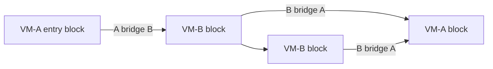

# Obfuscation and Multi-VM Design

[中文](zh-CN/obfuscation.md)

## Design objective

myVMP aims to remove a stable correspondence between source instructions and protected
bytes while preserving deterministic reproduction and bounded runtime cost. Diversity is
layered: no single permutation or cipher is treated as sufficient.

## Dynamic profile

A non-zero seed derives a complete `VmProfile`. Different seeds affect:

- logical-to-physical opcode permutation and duplicate semantic opcode selection;
- rolling payload keys and operand-window codec material;
- dispatcher comparison-domain constants and native handler variant masks;
- two- or three-stage immediate reconstruction templates and independent shares;
- non-entry basic-block order and explicit successor encoding;
- original-body trap fill and other placement-specific constants.

The profile manifest records enough information to reproduce and diagnose an output.
Reproducibility is deliberate: a failing seed can be investigated without making all
builds identical.

## Logical and physical opcodes

The common VM ISA has stable logical operations used by IR and tests. A profile maps them
onto physical opcode bytes. High-frequency operations also have duplicate physical
encodings selected per occurrence, so learning one physical value does not identify every
instance of the same semantics.

The native dispatcher reverses only the mapping needed for the current instruction and
selects a seed-derived handler implementation. Unsupported or malformed values enter a
fail-closed bad-opcode path.

## Unified operand codec

Every logical operation declares its operand width centrally. For all operations with
operands, the encoder mixes payload key material, physical opcode, physical instruction
offset and operand-byte position. The native runtime decodes the current operand window
immediately before its handler and re-encodes it before the next dispatch.

Consequences:

- the same register or immediate has different stored bytes at different positions;
- adding an opcode with a declared layout automatically enters the codec contract;
- a plaintext global operand stream is not left beside encrypted opcode bytes;
- handler decoding remains consistent across the full logical opcode set.

## Immediate polymorphism

Constants and immediate operations are reconstructed through seed-, block- and
instruction-specific equivalent sequences. Examples include XOR shares, modular
add/subtract shares and mixed three-stage forms. Branch targets are remapped after
expansion using actual physical sizes, not assumed logical positions.

This is bounded polymorphism rather than arbitrary MBA generation: templates are small,
fully covered by host semantics and validated under QEMU. It reduces literal exposure
without allowing uncontrolled expression growth.

## CFG-aware blocks

The encoder discovers IR basic-block leaders and assigns stable logical identities.
Physical images carry block ranges and explicit successors. Non-entry blocks may be
shuffled because conditional fallthrough, jumps and VM-call continuation do not rely on
source adjacency.

Encryption evolves per physical block using CFG identity and owning profile. Only
boundary information required for execution is stored; derived rolling keys are not
serialized as a plaintext table. Identical logical bytes placed in different blocks or
owned by different sibling profiles therefore receive different streams.

## Superoperators and handler variants

Bounded superoperators combine selected adjacent compare/test and branch patterns inside
one block. Fusion is forbidden across branch targets, calls, memory-order boundaries or
operations whose trapping behavior cannot safely be combined.

Native runtimes contain alternative implementations for common arithmetic, logic,
comparison, move, memory, branch and select families. The current profile chooses variant
masks. This changes handler bodies and dispatcher paths in addition to changing bytecode.

## Sibling multi-VM

Sibling mode partitions physical CFG blocks between two independent profiles:

Each block has an owner. Every static cross-owner CFG edge has an explicit `VmBridge` containing
source/destination profile identifiers, continuation and destination blocks, state policy,
key epoch, memory-order metadata and a depth bound. The runtime derives the owner on every
block transition and switches opcode translation plus handler variants dynamically.

The native runtimes currently share one complete execution frame, so GPRs, FP/SIMD state,
SP, flags, VM return state and memory semantics do not pass through a lossy native ABI. The
host reference interpreter now additionally models distinct encoded state frames per
profile and applies reversible liveness-selected transformations at cross-profile edges.
While an internal VM call is active, cross-profile edges transfer complete state so caller
registers used after return survive; the host interpreter uses the continuation block's live-ins for
the dynamic return edge, which is not a static `VmBridge`. These state layouts and transforms
are not yet consumed by target assembly. CFG loops can cross profiles without
recursively nesting interpreter frames. Unknown owners, missing bridges, same-profile
bridges, inconsistent partitions and invalid depth metadata are rejected.

This design is intentionally different from unrestricted recursive virtualization. It
delivers per-block VM changes without multiplying interpreter stacks or exception/call ABI
risk. Selective nested protection remains a possible experiment, not a current claim.

## What varies at each level?

| Level | Operational variability |
|---|---|
| Build | seeds, keys, dispatcher constants, runtime variants, trap fill |
| Function | profile(s), CFG partition, physical block order |
| Basic block | owner profile, rolling key domain, successor encoding |
| Instruction | physical/duplicate opcode, operand window, immediate template |
| Handler entry | current mapping entry, decoded operands, selected native variant |

## Quality gates

The project measures, among other things:

- unique payloads/manifests across seeds;
- minimum and average pairwise ciphertext distance;
- same-position byte overlap and longest equal run;
- aligned word and arbitrary literal-window exposure;
- output-size and runtime ratios;
- multi-VM bridge count and ownership balance;
- complete original/protected behavior under QEMU.

These tests detect regressions such as a fixed opcode map or exposed constants. They do
not prove that a skilled analyst cannot recover semantics. See the
[security model](security-model.md) and [analysis guide](analysis-and-reports.md).

## Experimental attacker and synthesis models

`scripts/reference_devirtualizer.py` extracts the encrypted VM byte range and correlates
its block hashes with exposed sidecar metadata. It is an attacker-side observation oracle,
not a semantic devirtualizer: it does not undo runtime whitening, operand-window transforms,
or reconstruct handlers.

Two host-side models are also available. The superoperator miner reports
bounded, repeated, side-effect-free scalar opcode sequences confined to a single CFG block;
it does not emit bytecode or handlers. The state-representation model provides reversible
profile-local GPR, FP, vector, flags, and SP layouts and live-mask transforms. The host
sibling interpreter executes this model; native runtime bridges do not consume it yet.
Neither model currently changes emitted native protection bytes.

## AArch64 Advanced SIMD

The AArch64 backend has an explicit fixed-width 128-bit Advanced SIMD subset. It uses a
32-register `Vector128` file separate from scalar GPRs, typed 8/16/32/64-bit lanes, nine
seed-mapped VM opcode families and the same per-instruction operand codec used by scalar
bytecode. Implemented families cover integer add/sub and bitwise operations, signed
compare, bit select, immediate logical shifts, `EXT`, Q load/store, FP32/FP64 vector
add/sub/mul/div and zero materialization. Native calls synchronize q0-q7 while preserving
the VM-owned vector frame; sibling profiles independently remap all vector opcodes.

Only Q=1 fixed 128-bit forms in the documented subset are accepted. Other NEON forms,
AArch64 SVE/SVE2/SME and RV64 Vector remain fail-closed rather than being silently
scalarized.
