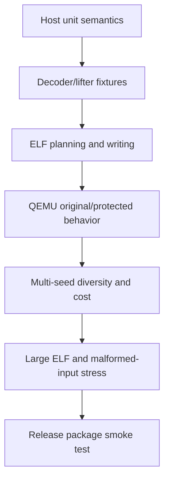

# Testing and Release Validation

[中文](zh-CN/testing.md)

## Test layers



Host tests prove IR, bytecode, codecs, profile validation, VM execution and branch
encoders. Target tests compile real functions, protect them and compare complete program
behavior under QEMU. Quality tests then ensure equivalent outputs are not accidentally
identical across seeds.

## Core commands

```sh
make test
make integration-test
make generated-fixture-test
```

## AArch64 release gates

```sh
make arm64-integration-test
make arm64-micro-lift-test
make arm64-liftability-report
make arm64-protect-dry-run-test
make arm64-elf-patch-test
make arm64-vm-protect-test
make arm64-far-elf-test
make bytecode-seed-sweep
make multi-vm-quality-test
make check-aarch64-runtime
```

The VM behavior suite covers scalar integer/flags/control flow, memory widths and modes,
direct/indirect/tail/internal calls, GOT/global addressing, scalar FP32/FP64 and conditional
FP, exclusive/acquire/release atomics and supported Armv8.1 compare/exchange. Sibling tests
exercise branch, call and memory CFGs.

`arm64-far-elf-test` builds a real PIE with more than 129 MiB of executable file-backed
padding. It forces the payload beyond direct-branch range, verifies the
`ADRP/ADD/BR` detour and compares behavior under QEMU.

## RV64 release gates

```sh
make riscv64-fixture-test
make riscv64-liftability-report
make riscv64-vm-protect-test
make riscv64-elf-stress-test
make riscv64-multi-vm-quality-test
make check-riscv64-runtime
```

The stress suite covers static/non-PIE, PIE, lazy/immediate binding, shared objects,
global/GOT access, calls, TLS/RELRO-sensitive layouts, batch protection, large placement,
loops, switches and mixed-width RVC/native instruction streams used by the corpus.

## ARM32/A32 release gates

```sh
make arm32-elf-parser-test
make arm32-vm-protect-test
make check-arm32-runtime
```

The QEMU gate executes the same real ELF before and after protection with two independent
single-VM seeds and sibling multi-VM. Its A32 corpus covers integer/logical operations,
shifted operands, flags and predicates, memory, multiplication, CFG blocks and return.

## Quality acceptance

Seed sweeps require unique payloads and manifests. Sibling suites require behavior
equality, actual bridges, meaningful ownership balance, high pairwise ciphertext distance
and bounded output/runtime ratios. Numeric thresholds live in the scripts so changes are
reviewed with the measurement logic.

## Pre-release checklist

1. Start from a clean build directory and run `make -j$(nproc) test`.
2. Run `make docs-check` to validate local links and bilingual document parity.
3. Verify all checked-in runtime blobs.
4. Run the complete AArch64, ARM32 and RV64 gates available in the release environment.
5. Run ASan/UBSan and `git diff --check`.
6. Build `make package`, unpack it in a temporary directory and run `myvmp --help`.
7. Protect and execute one AArch64, ARM32 and RV64 smoke fixture using the packaged tool.
8. Confirm English/Chinese docs and all relative links are included.
9. Record compiler, cross-toolchain, QEMU and host versions with release artifacts.

Missing optional tools may cause individual scripts to skip. A public release should use
an environment where primary architecture gates execute rather than skip.
