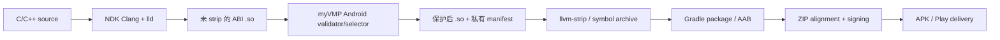

# Android 原生保护——长期调研规划

[English](../android-vision.md)

> 状态：仅调研。本文件不表示 Android 已受支持，也不授权立即实现。这里的“Android
> 保护”仅指 NDK 共享库中的选定函数，不包含 Java/Kotlin/Dex、资源或整个 APK。

## 结论

Android `arm64-v8a` 原型可以大量复用 myVMP，但生产级支持并不是替换一个 ELF 标识。
Android 原生代码仍是 ELF，因此 AArch64 decoder、IR、bytecode、动态 profile、multi-VM
模型和大部分 runtime 语义都有直接价值。真正困难的是 Android linker 约束下的 ET_DYN
安全改写、构建流水线位置、strip 后函数选择、4/16 KiB page、APK/AAB 打包签名，以及
跨 API/device 验证。

远景目标应定义为 **Android NDK library protection pipeline**，先做 `arm64-v8a`：在
native link 之后、strip/package/alignment/sign 之前改写未 strip 的 `.so`。直接修改已经
签名的 APK 不应成为主架构。

假定一名熟悉 binary tooling 的工程师和一个受控示例应用，arm64 PoC 大致是数周级；
把兼容性和发布门禁算入后，生产级 arm64-v8a 更可能是数月级。完整 ABI 覆盖明显更大：
`armeabi-v7a` 默认产生 Thumb-2，x86/x86-64 则需要新后端。这些只是规划量级，不是工期承诺。

## Android 工件与约束

Android 应用通常同时包含 ART bytecode 和 native `.so`。NDK ELF 位于 APK 的
`lib/<abi>/lib<name>.so`；公开 ABI 包括 `armeabi-v7a`、`arm64-v8a`、`x86`、`x86_64`，
且均为小端。fat APK 可以包含多份 ABI，App Bundle 则由 Google Play 生成设备 APK。
[Android ABI](https://developer.android.com/ndk/guides/abis)

`.so` 经 `System.loadLibrary`、Bionic linker 和 namespace policy 加载。Android 推荐
`JNI_OnLoad + RegisterNatives`，并用 version script 隐藏其他符号。release `.so` 可能没有
可供名称选择的 `.symtab`，所以必须在 strip 前保护，或消费 linker 产生的 range manifest。
[JNI 指南](https://developer.android.com/ndk/guides/jni-tips)、
[符号可见性](https://developer.android.com/ndk/guides/symbol-visibility)

native library 可以不解压而直接从 APK 加载。当前 Android 还要求 native dependency 与
ELF PT_LOAD 兼容 16 KiB page；NDK r28 默认生成 16 KiB alignment。
[打包行为](https://developer.android.com/guide/topics/manifest/application-element)、
[16 KiB page](https://developer.android.com/guide/practices/page-sizes)

## 推荐流水线

transform 必须在签名前发生。`apksigner` 明确说明：签名后修改 APK 会让签名失效，且
`zipalign` 必须先于签名。可以把“解包 unsigned APK、改写各 ABI、重打包、对齐、签名”
作为 fallback，但它更脆弱，也不适合由 AAB/Play 生成 APK 的流程。
[apksigner](https://developer.android.com/tools/apksigner)、
[应用签名](https://developer.android.com/studio/publish/app-signing)、
[Bundle/命令行构建](https://developer.android.com/build/building-cmdline)

建议集成点：

1. 核心提供单个未 strip NDK `.so` 的 standalone 命令，输入 ABI、symbol/range manifest、
   minSdk 和输出路径；
2. Gradle wrapper 只负责定位 native artifact，不让核心库绑定不稳定的 AGP 内部 API；
3. 提供 link 后、strip/package 前的 CMake/ndk-build 示例；
4. myVMP 只验证 packaging，不管理 APK/AAB 私钥，签名继续由现有 release system 负责。

## 现有资源复用评估

| 现有模块 | 复用程度 | Android 增量工作 |
|---|---:|---|
| AArch64 decoder/lifter/scalar | 高 | 扩大 NDK/Clang corpus 与 Android call/addressing forms |
| ARM32 A32 frontend | 有限 | NDK 默认 Thumb-2；强制 ARM mode 只能作为受限方案 |
| RV64 frontend | 仅远期 | 当前不是公开 NDK app ABI，不应宣称 Android 支持 |
| 公共 IR/bytecode/operand codec | 很高 | Android qualification、limits、manifest fields |
| 动态 sibling multi-VM | 高 | JNI call、exception、thread、stack budget 验证 |
| arm64 native runtime | 高 | Bionic ABI、BTI/PAC property、unwind policy 审计 |
| ELF parser/planner | 中高 | Android relocation/note/dynamic tag/RELR/packed form |
| ELF writer/detour | 中 | 保持 4/16 KiB PT_LOAD、GNU RELRO、APK 直接加载 |
| sidecar/quality report | 高 | 详细 manifest 默认只留在私有 CI artifact |
| Linux QEMU suite | 部分 | 增加 emulator/device、adb/logcat、JNI、API matrix |

当前 runtime 从 ELF executable mapping 执行解释器，mutable bytecode/state 位于 data/stack，
原则上不要求 JIT 式 RWX mapping，对 Android W^X 是有利条件；但必须在真实 Android loader
验证，不能用 Linux QEMU 结果代替。

## 必须完成的工程

### 1. 定义 artifact 和 ABI contract

- v1 只保护 app 自有 NDK `.so` 的选定 scalar function，先做 `arm64-v8a`；明确排除
  system/framework library、Dex 和 resource。
- manifest 记录 `minSdk`、ABI、NDK/Clang/LLD/AGP、page-size mode 与 JNI registration。
- 明确 exception/unwind、sanitizer、LTO、CFI 是首版拒绝还是修复 metadata 后支持。

### 2. 让函数选择适配 release build

- 尽可能在 strip 前保护。
- 支持 source/link 阶段生成的稳定 symbol/section/address range/build-ID selection file，
  不能只依赖 `.symtab`。
- 保持 `JNI_OnLoad`、导出 JNI entry 和 `RegisterNatives` 引用地址有效。
- 定义 ICF、LTO cloning、COMDAT、local/hidden symbol 行为。

### 3. Android ET_DYN writer

- 建立多 NDK/API `.so` corpus。
- 验证 Android/AArch64 与 ARM relocations、GNU/Android RELR/packed relocation、`.dynamic`、
  GNU hash、build ID、symbol version 和 RELRO。
- 保证 `p_offset ≡ p_vaddr (mod p_align)`，同时测试 4 KiB/16 KiB PT_LOAD。
- 测试 PIE load bias、ASLR、APK 直接加载、binding 与 linker namespace。Bionic 文档记录了
  RELR 等 Android linker 演进：[Bionic linker changes](https://android.googlesource.com/platform/bionic/+/master/android-changes-for-ndk-developers.md)。
- 首版对无法保持 exception/unwind 语义的函数应失败关闭。

### 4. Runtime/JNI/ABI qualification

- 分别测试普通 JNI、`@FastNative`、`@CriticalNative`；后者会改变 native signature 且有
  API-level 限制。
- 验证 thread-local `JNIEnv`、ART callback、native helper、signal、stack alignment、线程
  stack size 和 recursion depth。
- 审计 AArch64 GNU property、BTI/PAC；不能为了加载而删 property。
- 在真机测 startup、JNI latency、memory、APK/AAB size，而不只用 emulator。

### 5. Packaging integration

- 把保护后 `.so` 交给 Gradle `jniLibs` 或 external native build 打包。Android 支持
  CMake/ndk-build 和 prebuilt library：
  [Gradle native integration](https://developer.android.com/studio/projects/gradle-external-native-builds)、
  [NDK CMake](https://developer.android.com/ndk/guides/cmake)。
- 验证 ABI path、compression、ZIP/page alignment。
- Gradle/Play App Signing/现有 release system 继续持有签名密钥；myVMP 不接收生产私钥。
- seed 与详细 profile manifest 只保存在私有 CI，不随 APK 发布。

### 6. Android release gates

- 每个支持 ABI 的最小 JNI app 和确定性 native behavior。
- debug/release、strip/unstrip、APK/AAB、extract/direct-load、4/16 KiB 组合。
- emulator + 代表性真机/API；比较 JNI result、crash、logcat、load time、memory。
- `readelf`/`llvm-readobj`、`zipalign -c`、`apksigner verify`、`bundletool` alignment、安装与
  upgrade test。
- stripped selection、unsupported relocation、Thumb、malformed package、unwind/CFI conflict、
  detour space 不足等负面 fixture。

## 难度分解

| 里程碑 | 难度 | 原因 |
|---|---:|---|
| standalone arm64-v8a `.so` PoC | 中 | ISA/VM 已有，Android ET_DYN/package 验证没有 |
| 生产级 arm64-v8a Gradle pipeline | 高 | toolchain matrix、symbol、16 KiB、签名顺序和设备测试 |
| 强制 `-marm` 的受限 armeabi-v7a | 中高 | A32 可复用，但 compiler corpus/Android ABI 仍需验证 |
| 正常 armeabi-v7a | 很高 | 默认 Thumb-2 且可用 Neon，当前 A32 后端均未覆盖 |
| x86/x86_64 Android | 很高 | 新 frontend/runtime/detour |
| Java/Kotlin/Dex | 独立项目 | 格式、runtime、威胁模型不同，native VM 不是捷径 |
| turnkey APK/AAB multi-ABI | 很高且长期 | 所有 backend 加 Gradle/Play/持续兼容矩阵 |

## 建议阶段路线

1. **Feasibility corpus：**收集目标 NDK 的 strip/unstrip arm64-v8a `.so`，只做 liftability
   和 layout report，不写文件。
2. **Standalone arm64 `.so`：**保护 strip 前选定的 hidden scalar function，在最小 JNI app
   的 emulator 与 16 KiB image 上加载执行。
3. **Android-safe writer：**通过 relocation、RELRO、4/16 KiB、direct-from-APK、malformed
   gates，并定义 Android manifest schema。
4. **Build integration：**提供 versioned wrapper 与 Gradle/CMake 示例，签名前验证 APK/AAB。
5. **Production qualification：**NDK/AGP/API/device matrix、性能预算、crash 诊断、复现与升级。
6. **ABI expansion：**根据真实需求选择 Thumb-2 或 x86-64；只有 arm64 时不得声称完整
   Android coverage。

## 开发前决策门

开始实现前必须确定最低 Android API、支持的 NDK/AGP 范围、首个 ABI、symbol selection
集成，以及 unwind、LTO/CFI、16 KiB 策略。第一项交付应是 compatibility/liftability
报告，而不是 APK rewriting 命令。

