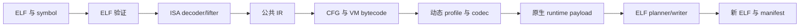
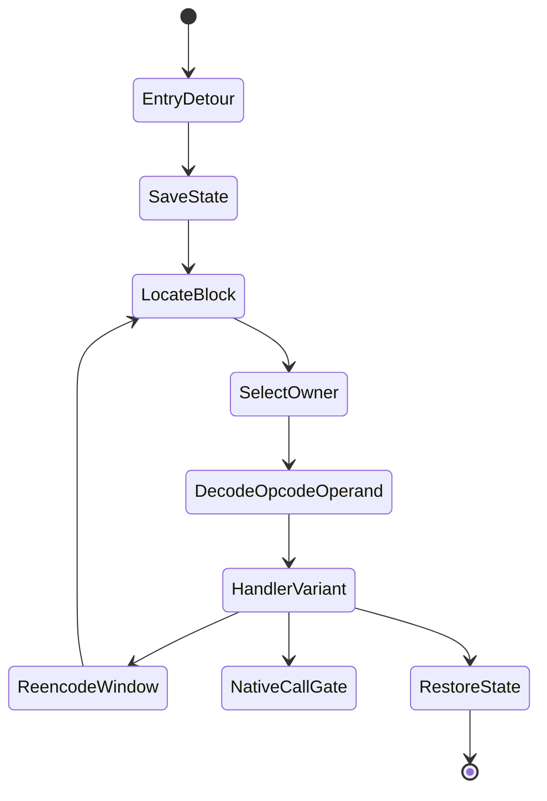

# 架构与保护流水线

[English](../architecture.md)

## 范围

myVMP 是宿主侧二进制转换器，保护单位是已链接小端 ELF 可执行文件或共享对象中的具名
函数。它不解析 C/C++，不依赖 LLVM pass，也不替换系统 loader。输出仍是原生 ELF，
只有执行到被保护函数时才进入嵌入的目标 ISA 解释器。

每一阶段先构造完整结果再交给下一阶段。失败不会修改输入，也不会发布半成品输出。

## 模块边界

`src/elf` 把 ELF32/ELF64 解析成统一的 segment、section、symbol 和 relocation 模型，
在索引前验证表大小、文件范围和虚拟地址范围。`src/patch` 负责架构相关入口编码以及 ELF
writer。PC 相对距离采用公共的无溢出计算；AArch64/RV64 共用参数化 ELF64 布局引擎，
但各自保留跳板编码。AArch64 会按距离选择直接分支、位置无关 `ADRP/ADD/BR` 远跳，
或受支持的 non-PIE literal fallback。
ARM32 在范围内使用 A32 直接分支，远距离 ET_EXEC 使用 8 字节绝对 literal 跳板；地址
溢出或入口空间不足时失败关闭。

`src/arm64`、`src/riscv64` 和 `src/arm32` 只负责原生语义：寄存器角色、宽度、PC 相对
寻址与副作用。未知指令不会作为 opaque opcode 放行，而是拒绝整个函数。

`src/ir` 表达寄存器、flags、内存、控制流、调用、浮点和已支持原子的架构无关语义。
显式 block/successor 使物理布局可以变化而逻辑 CFG 不变。validator 会拒绝非法寄存器、
宽度、target 和无有效退出的程序。

`src/bytecode` 是逻辑 VM ISA、operand width、物理 opcode domain、profile 与 payload
编码的唯一事实来源。目标 runtime 通过公共 format/profile table 消费同一协议。

`src/vm/vm.cpp` 是用于快速语义测试的 host interpreter；`src/vm/multi_vm.cpp` 定义
sibling owner、bridge metadata 和验证。host normalization 只用于测试；真实保护文件会
在原生 runtime 中动态解码当前 profile。

`runtime/*.S` 是可审查的原生解释器源码。生成脚本用交叉工具链产生仓库内的 byte include，
因此普通宿主构建不要求 cross assembler；`make check-*-runtime` 验证源码与 blob 一致。

三种 runtime 都在执行时通过 seed-specific translation table 解析物理 opcode，并以位置、
物理 opcode 与 block owner 派生的流解码 operand window。ARM32 sibling 模式把 CFG block
分配给两个 profile，并在显式 VM 控制流边上切换 domain。

`src/protect` 串联验证、lifting、encoding、runtime 和 patch。各 ISA protector 返回公共
结果；sidecar 发布集中处理并在索引 sibling metadata 前验证。`protect-many` 会 staging
所有函数，只有全部成功才以事务方式发布 ELF 和 metadata。

## 一次保护的完整步骤

1. 解析 ELF 并解析唯一、非空的 symbol range。
2. 验证 machine/class、可执行文件映射和入口 patch 空间。
3. 分类 relocation，并向 lifter 提供 file-backed address reader。
4. 使用真实 VA 解码和提升完整函数。
5. 验证 IR，发现 CFG leader、block 和显式 successor。
6. 生成一到两个 profile，将 IR 降级为物理 bytecode blocks。
7. 应用立即数多态、重复 opcode、受限 superoperator、块布局变化、operand encoding 与
   rolling block encryption。
8. 构造目标架构原生 runtime。
9. 规划可执行对齐空间，修复 ELF offset/segment size，安装近跳或远跳入口。
10. 用 seed 派生的 trap fill 销毁剩余原生函数体。
11. 写出新 ELF 以及 profile/owner manifest。

## 运行时路径

dispatcher 每次根据当前物理块推导 owner，而不是让整个函数固定使用一个 VM。operand
window 只在进入当前 handler 前解码，并在下次 dispatch 前重新编码。

新增 ISA 应实现 decoder/lifter、runtime builder、trampoline 和 ELF target traits，复用
公共 IR、bytecode、profile、sibling model、manifest 与质量工具。新增逻辑 opcode 必须
同时提供 IR 语义、唯一 operand layout、host 执行、目标 handler 和测试。
