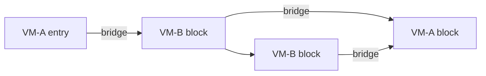

# 混淆与 Multi-VM 设计

[English](../obfuscation.md)

## 目标

myVMP 希望在保持可复现和成本有界的前提下，消除源指令与保护字节之间的稳定对应关系。
它采用多层差异，而不是把单一 opcode permutation 或加密当成完整保护。

## 动态 profile

非零 seed 会派生完整 `VmProfile`，影响逻辑到物理 opcode 映射、重复语义 opcode、rolling
payload key、operand-window codec、dispatcher 常量、handler variant mask、两/三级立即数
重构、非入口块顺序和原生函数体 trap fill。manifest 记录复现和诊断所需信息；可复现是
为了调查失败 seed，并不意味着不同构建保持相同外观。

## Opcode 与 operand codec

公共 VM ISA 使用稳定逻辑操作，profile 将其映射为物理 opcode。高频操作有逐次选择的重复
物理编码，因此同一语义不只有一个值。runtime 只反向解析当前指令需要的 mapping，畸形值
进入失败关闭路径。

每个逻辑 opcode 在中心位置声明 operand width。所有带 operand 的指令都会混合 payload
key、物理 opcode、物理偏移和 operand byte position。runtime 仅在 handler 前解码当前
window，并在下一次 dispatch 前重新编码。因此相同寄存器或立即数在不同位置保存为不同字节，
也不会在 opcode 旁保留全局明文 operand stream。

## 立即数与 CFG 多态

常量会通过由 seed、block 和 instruction identity 选择的 XOR share、模加减 share 与混合
三级模板重构。扩展后根据真实物理大小重新映射 branch target。

encoder 为 IR 基本块分配稳定逻辑 ID，并保存物理 block range 与显式 successor。非入口块
可以重排，因为 fallthrough、jump 和 VM call continuation 不依赖源顺序相邻。加密状态按
block identity 和 owner profile 演化；相同逻辑字节位于不同 block/owner 时也使用不同流。

## Superoperator 与 handler variant

受限 superoperator 合并同一块中的部分 compare/test + branch 模式，但不会跨越 branch
target、call、memory-order boundary 或无法安全组合 trap 行为的操作。原生 runtime 为常见
算术、逻辑、比较、移动、内存、分支和 select 提供不同 handler，profile 选择 variant mask。

## Sibling multi-VM

sibling 模式把物理 CFG block 分配给两个独立 profile。跨 owner 边必须有显式 `VmBridge`，
其中包含源/目标 profile、continuation/destination block、状态策略、key epoch、内存顺序和
深度上限。runtime 在每次 block transition 动态推导 owner，并切换 opcode translation 和
handler variants。

两个 VM 共用一个完整执行 frame，GPR、FP/SIMD、SP、flags、VM return state 和内存语义
无需经过有损 native ABI。CFG loop 可以跨 profile，而不会递归压入 interpreter frame。
未知 owner、缺失/同 profile bridge、不一致 partition 和非法深度会被拒绝。

## 每层的可操作变化

| 层级 | 动态内容 |
|---|---|
| 构建 | seed、key、dispatcher 常量、runtime variant、trap fill |
| 函数 | profile、CFG partition、物理块顺序 |
| 基本块 | owner、rolling key domain、successor encoding |
| 指令 | 物理/重复 opcode、operand window、立即数模板 |
| handler | 当前 mapping、解码 operand、原生 variant |

质量门禁检查唯一 payload/manifest、pairwise ciphertext distance、相同位置重合、literal
暴露、size/runtime ratio、bridge count、owner balance 和 QEMU 行为一致。这些指标可以
发现退化，但不能证明专业分析者无法恢复语义。

## AArch64 Advanced SIMD

AArch64 后端现提供显式的固定 128 位 Advanced SIMD 子集。它使用独立于 GPR 的 32 个
`Vector128` 寄存器、8/16/32/64 位 typed lane、九类随 seed 映射的 VM opcode，以及与标量
字节码相同的逐指令 operand codec。已实现整数 add/sub、bitwise、signed compare、bit
select、立即数逻辑 shift、`EXT`、Q load/store、FP32/FP64 vector add/sub/mul/div 和清零。
native call 同步 q0-q7 并保留 VM vector frame；sibling profile 独立重映射全部 vector opcode。

只接受文档所列 Q=1 固定 128 位形式。其他 NEON 形式、SVE/SVE2/SME 和 RV64 Vector 仍然
失败关闭，不会静默标量化。
