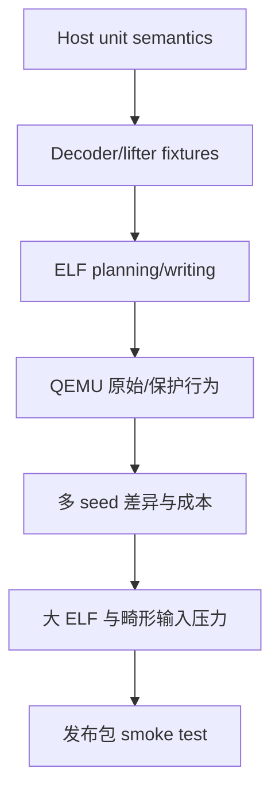

# 测试与发布验证

[English](../testing.md)



host tests 验证 IR、bytecode、codec、profile、VM 和 branch encoder。目标测试编译真实
函数、执行保护，并在 QEMU 下比较完整程序。质量测试保证行为等价的不同 seed 输出没有
退化成固定外观。

## 基础门禁

```sh
make test
make integration-test
make generated-fixture-test
```

Pull request 的 GitHub Action 有意只运行快速的仓库卫生检查、严格 host 构建、host 单元测试
和版本检查。交叉编译、QEMU、seed sweep、大 ELF 及 runtime 生成门禁资源消耗较高，不再对
每次 push 强制执行；发布或专用硬件测试 job 中再运行下面的架构专项命令。

## AArch64

```sh
make arm64-integration-test
make arm64-micro-lift-test
make arm64-liftability-report
make arm64-protect-dry-run-test
make arm64-elf-patch-test
make arm64-vm-protect-test
make arm64-simd-test
make arm64-far-elf-test
make bytecode-seed-sweep
make multi-vm-quality-test
make check-aarch64-runtime
```

行为 suite 覆盖 scalar integer/flags/control flow、各种内存宽度、直接/间接/tail/internal
call、GOT/global、scalar FP32/FP64 与 conditional FP、exclusive/acquire/release atomic 和
已支持的 Armv8.1 compare/exchange。sibling 测试覆盖 branch、call 与 memory CFG。

`arm64-simd-test` 在 single 与 sibling 模式保护真实 Advanced SIMD 函数并对比 QEMU 输出，
覆盖整数 lane、bitwise/compare/select、shift、`EXT`、Q memory、FP32/FP64 vector 算术、
清零和 q0-q7 native-call 同步；同时检查两个 sibling profile 对九类 vector opcode 使用不同
物理值。

`arm64-far-elf-test` 构建超过 129 MiB 的真实 PIE，强制 payload 超出 direct branch 范围，
检查 `ADRP/ADD/BR` 并在 QEMU 对比行为。

## RV64

```sh
make riscv64-fixture-test
make riscv64-liftability-report
make riscv64-vm-protect-test
make riscv64-elf-stress-test
make riscv64-multi-vm-quality-test
make check-riscv64-runtime
```

压力 suite 覆盖 static/non-PIE、PIE、lazy/immediate binding、shared object、GOT/global、
call、TLS/RELRO layout、batch、大位置、loop、switch 与 corpus 中的 RVC mixed-width。

## ARM32/A32

```sh
make arm32-elf-parser-test
make arm32-vm-protect-test
make check-arm32-runtime
```

QEMU 门禁用两个 single-VM seed 与 sibling multi-VM 执行同一真实 ELF，覆盖 A32
integer/logical、shifted operand、flags/predicate、memory、multiply、CFG block 与 return。

发布前应从干净 build 开始，执行 `make docs-check`，验证所有 runtime blob，运行两架构完整门禁、ASan/UBSan 和
`git diff --check`，再 `make package`、解包、检查 `--help`，并用包内工具执行 AArch64、
ARM32、RV64 smoke test。公开发布环境必须让主要门禁实际执行，而不是因缺工具跳过。
